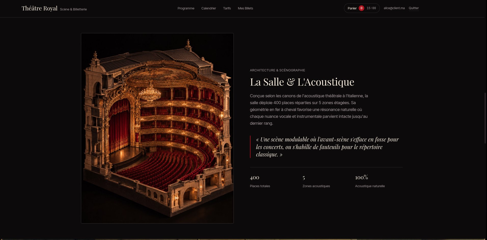
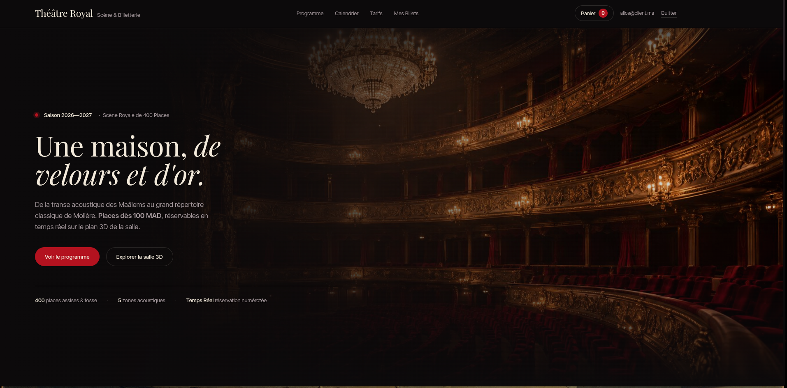

# Théâtre Royal

> **EMC Challenge PFE 2026** — **Sujet 1 : Billetterie d'une salle de spectacle (400 places)**  
> Application web complète sous Symfony 7.4, MySQL 8, Redis, Three.js et Docker.

## Documentation et livrables attendus

| Livrable | Description | Lien |
|---|---|---|
| **Note conceptuelle** | Approche de conception, arbitrages, place de l'IA et vision (PDF) | [`docs/note_conceptuelle.pdf`](docs/note_conceptuelle.pdf) |
| **Modèle de données** | Schéma 3NF, diagramme Mermaid et justification des choix | [`docs/MODELE.md`](docs/MODELE.md) |
| **Journal des décisions** | Réponses aux 5 questions à trancher et historique des choix techniques | [`docs/DECISIONS.md`](docs/DECISIONS.md) |
| **Journal IA** | Traces d'utilisation de l'IA, corrections humaines et transcripts de sessions | [`docs/ai-log/`](docs/ai-log/) |
| **Tests automatisés** | Suite PHPUnit couvrant concurrence, verrous Redis et API (21 tests, 125 assertions) | [`tests/`](tests/) |
| **Variables d'environnement** | Exemple documenté sans aucun secret | [`.env.example`](.env.example) |
| **Guide de déploiement** | Procédure d'installation Docker en une commande | [`INSTALL.md`](INSTALL.md) |

## Niveaux atteints

| Niveau | Thème | État |
|---|---|---|
| 1 | Modéliser | Fait |
| 2 | Faire respecter les règles | Fait |
| 3 | En faire un produit | Fait |
| 4 | API externe (Google Sheets) | Fait |
| 5 | Livrer (Docker, INSTALL.md) | Fait |

## Démarrage

Prérequis : Docker Engine, Docker Compose v2 et Git.

```bash
chmod +x bin/install && ./bin/install
```

Cette commande crée la configuration locale, construit les conteneurs, installe les dépendances,
applique les migrations, charge les données de démonstration et démarre le scheduler.

Application : <http://localhost:8000>

Guide complet : [`INSTALL.md`](INSTALL.md)

## Aperçu





## Comptes de démonstration

| Rôle | Email | Mot de passe |
|---|---|---|
| Client | `alice@client.ma` | `Client123!` |
| Guichetier | `guichet@theatre.ma` | `Guichet123!` |
| Administrateur | `admin@theatre.ma` | `Admin123!` |

## Fonctionnalités principales

- Parcours d'achat avec réservation temporaire Redis de 15 minutes.
- Salle 3D interactive avec configurations théâtre, concert et conférence.
- Coupons, idempotence de paiement et protection contre la double vente.
- Billets PDF avec QR code, espace client et contrôle cashier.
- Tableaux de bord administrateur et guichetier.
- Synchronisation automatique des ventes et remboursements vers Google Sheets.

## Ce qui reste à faire (Perspectives)

- **Tests de charge :** scénarios Gatling / k6 simulant l'ouverture de billetterie sous haute concurrence.
- **Passerelle bancaire réelle :** intégration Stripe Elements en complément de la simulation actuelle.
- **Outbox distribué :** passage de la table MySQL outbox à Apache Kafka pour multiplier les consommateurs analytiques.
- **Accessibilité :** conformité WCAG sur les contrôles alternatifs au plan 3D WebGL.

