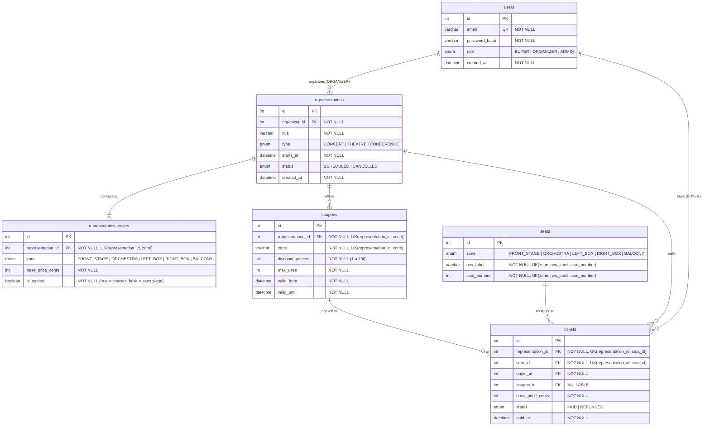

# Modèle de données

Ce document présente le schéma relationnel MySQL 8 de la billetterie pour une salle de spectacle modulable de 400 places, ainsi que la justification des choix de normalisation et d'intégrité.

## 1. Diagramme Entité-Relation (Mermaid)

## 2. Énumérations du domaine (PHP 8.2 Backed Enums)

Les valeurs fermées du domaine sont modélisées par des énumérations typées :

- **`UserRole`** : `BUYER`, `ORGANIZER`, `ADMIN`.
- **`ZoneName`** : découpe les 400 places de la salle unique en 5 volumes architecturaux pour le plan et la vue 3D :
  - `FRONT_STAGE` (Avant-scène / Fosse, 80 places)
  - `ORCHESTRA` (Parterre central, 160 places)
  - `LEFT_BOX` (Loges gauche, 30 places)
  - `RIGHT_BOX` (Loges droite, 30 places)
  - `BALCONY` (Grand balcon haut, 100 places)
- **`EventType`** : `CONCERT`, `THEATRE`, `CONFERENCE`.
- **`RepresentationStatus`** : `SCHEDULED`, `CANCELLED`.
- **`TicketStatus`** : `PAID`, `REFUNDED`.

## 3. Justification des choix de conception

### Absence des tables `venues` et `zones`
L'énoncé porte sur une salle de spectacle unique de 400 places. Créer une table `venues` à une seule ligne ou une table `zones` figée à 5 lignes imposerait des jointures SQL sans valeur fonctionnelle. L'énumération `ZoneName` appliquée directement sur `seats.zone` et `representation_zones.zone` garantit que les 400 sièges se répartissent exactement sur les 5 zones connues du modèle 3D.

### Configuration par représentation (`representation_zones`)
Une même salle accueille des pièces de théâtre entièrement assises et des concerts avec fosse debout. La table `representation_zones` relie chaque représentation aux 5 zones de la salle avec deux paramètres choisis par l'organisateur :
1. **`base_price_cents`** : le tarif plein de la zone en centimes (évite les erreurs d'arrondi en virgule flottante).
2. **`is_seated`** : indique si la zone comporte des fauteuils numérotés (`true`) ou un placement libre debout (`false`).

En base de données, chaque place vendue pointe toujours vers un enregistrement `seats` précis (`tickets.seat_id NOT NULL`). Ce choix élimine les colonnes nulles dans `tickets`, conserve le fonctionnement de la contrainte `UNIQUE(representation_id, seat_id)` en MySQL (où `NULL != NULL` désactiverait l'unicité), et unifie l'algorithme de réservation. Lorsque `is_seated` vaut `false`, l'interface 3D et le billet imprimé masquent simplement le numéro de siège.

### Normalisation des prix et des coupons (3NF)
- **Aucune colonne calculée redondante dans `tickets`** : la table `tickets` stocke `base_price_cents` (figé au moment de l'achat pour que la modification ultérieure du tarif d'une zone n'affecte jamais les billets déjà vendus) et la clé étrangère optionnelle `coupon_id`. Le pourcentage de réduction est lu sur `coupons.discount_percent`, et le montant net payé est calculé par `base_price_cents * (100 - discount_percent) / 100`.
- **Absence de compteur `used_count` dénormalisé sur `coupons`** : le nombre d'utilisations d'un coupon est obtenu par `COUNT(*)` sur les billets `PAID` associés à `coupon_id`. Lorsqu'une représentation est annulée et que ses billets passent à `REFUNDED`, le décompte se met à jour sans maintenance manuelle. Lors d'un achat avec coupon, la ligne `coupons` est verrouillée (`SELECT ... FOR UPDATE`) pendant la transaction pour respecter `max_uses` en cas d'achats simultanés.

### Séparation entre blocage temporaire (Redis) et vente comptable (MySQL)
MySQL 8 ne supporte pas les index uniques partiels (`WHERE`). Stocker des réservations temporaires de 15 minutes et leurs expirations dans la table `tickets` encombrerait l'arbre B-Tree de l'index `UNIQUE(representation_id, seat_id)` avec des paniers abandonnés.
- Les blocages temporaires de 15 minutes sont stockés en mémoire dans **Redis** via la commande atomique `SET hold:rep:{repId}:seat:{seatId} {buyerId} NX EX 900`.
- La table MySQL **`tickets`** ne reçoit un `INSERT` qu'à la validation effective du paiement (`PAID`), avec la contrainte `UNIQUE(representation_id, seat_id)` comme garantie finale d'intégrité.
