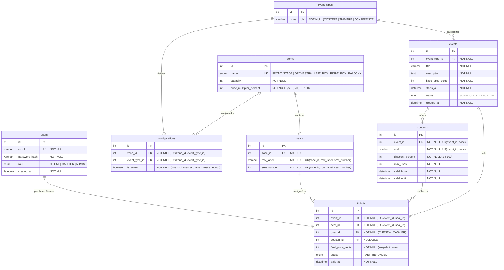

# Modèle de données

Ce document décrit le schéma relationnel MySQL 8 de la billetterie pour une salle de spectacle unique de 400 places modulables, ainsi que la justification des choix de normalisation et d'intégrité.

## 1. Diagramme Entité-Relation (Mermaid)

## 2. Énumérations du domaine (PHP 8.2 Backed Enums)

Les domaines finis et contrôlés sont modélisés par des enums PHP 8.2 :

- **`UserRole`** :
  - `CLIENT` : utilisateur grand public achetant en ligne.
  - `CASHIER` : guichetier vendant sur place (au comptoir ou par téléphone).
  - `ADMIN` : direction de la salle (création d'événements, gestion des prix et de la salle).
- **`ZoneName`** : les 5 zones architecturales formant les 400 places de la salle :
  - `FRONT_STAGE` (Avant-scène / Fosse, 80 places)
  - `ORCHESTRA` (Parterre central, 160 places)
  - `LEFT_BOX` (Loges gauches, 30 places)
  - `RIGHT_BOX` (Loges droites, 30 places)
  - `BALCONY` (Grand balcon haut, 100 places)
- **`EventStatus`** : `SCHEDULED`, `CANCELLED`.
- **`TicketStatus`** : `PAID`, `REFUNDED`.

## 3. Justification des choix de conception et 3NF

### A. Modularité de la salle via `event_types` et `configurations`
La salle physique compte exactement 400 places réparties sur 5 zones pérennes (`zones` et `seats`).
Pour répondre à l'exigence de modularité (*concerts, pièces de théâtre et conférences*) :
- La table **`event_types`** répertorie les types d'événements autorisés (`CONCERT`, `THEATRE`, `CONFERENCE`).
- La table **`configurations`** associe chaque zone à un type d'événement avec le booléen `is_seated`.
  - Exemple : pour `CONCERT`, `FRONT_STAGE` a `is_seated = false` (fosse debout), tandis que les autres zones restent assises (`is_seated = true`).
  - Pour `THEATRE`, les 5 zones ont `is_seated = true` (100% assis).
- Ce design évite d'encoder des noms de zones dans des colonnes booléennes (suppression de l'anti-pattern *Repeating Groups* / 1NF) et garantit une intégrité référentielle complète via des clés étrangères `zone_id` et `event_type_id`.

### B. Tarification par zone via multiplicateur (`price_multiplier_percent`)
Au lieu de maintenir 5 colonnes de prix par événement ou une table intermédiaire volumineuse :
- Chaque événement définit son **prix de base unique** : `events.base_price_cents`.
- Chaque zone applique un **multiplicateur fixe** : `zones.price_multiplier_percent` (ex: `0%` pour Balcon, `+20%` pour Fosse, `+50%` pour Orchestre, `+100%` pour Loges VIP).
- Le prix unitaire d'un siège se calcule sans ambiguïté : 
  $$\text{Prix zone} = \text{base\_price\_cents} \times \frac{100 + \text{price\_multiplier\_percent}}{100}$$
- Lors de l'achat, le montant final payé (après déduction éventuelle du coupon) est figé dans `tickets.final_price_cents`. Ce snapshot comptable garantit qu'une mise à jour ultérieure des tarifs n'altère jamais les billets déjà émis.

### C. Unicité du siège et zéro `NULL`
Même en configuration fosse debout (`is_seated = false`), chaque place reste matérialisée par une entrée dans la table `seats`.
- `tickets.seat_id` est strictement `NOT NULL`.
- L'index `UNIQUE(event_id, seat_id)` sur `tickets` protège nativement contre la double vente sous MySQL InnoDB.
- Lors de l'affichage ou de l'impression du billet, si `is_seated = false`, le numéro du siège est masqué pour indiquer *Placement libre / Fosse*.

### D. Réservations temporaires et concurrence (Redis + MySQL)
- Le panier temporaire de 15 minutes est géré en mémoire vive dans **Redis** via `SET hold:event:{id}:seat:{id} {userId} NX EX 900`.
- MySQL n'enregistre que les billets confirmés et payés (`tickets`), évitant ainsi d'encombrer l'index B-Tree avec des réservations expirées ou abandonnées.
